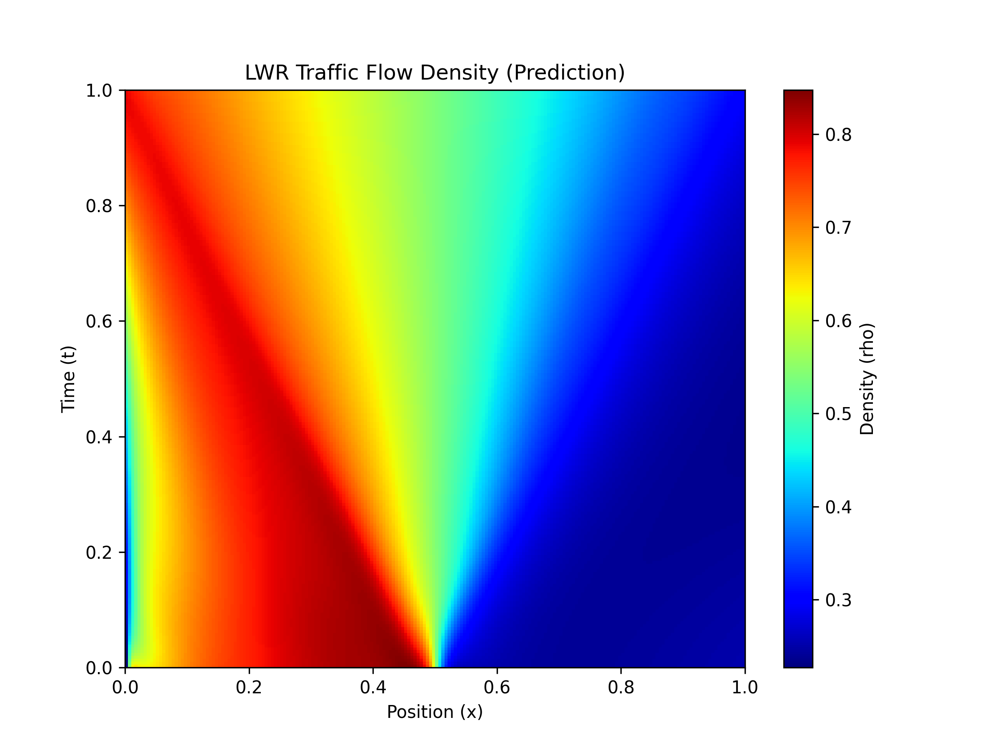
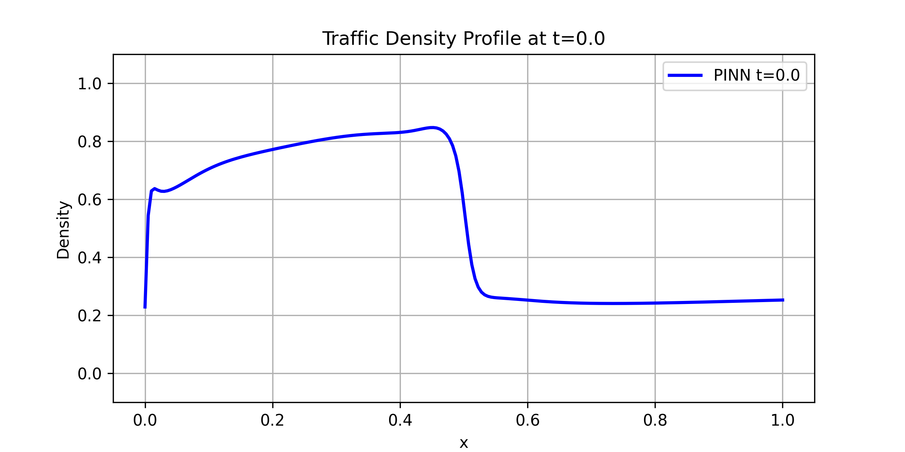
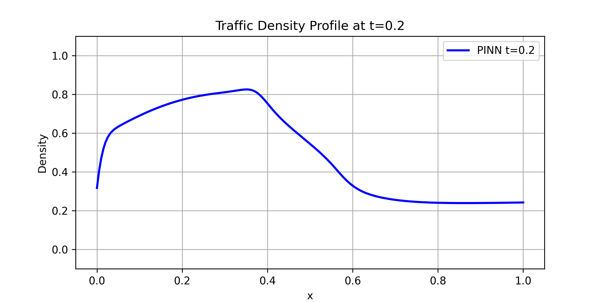
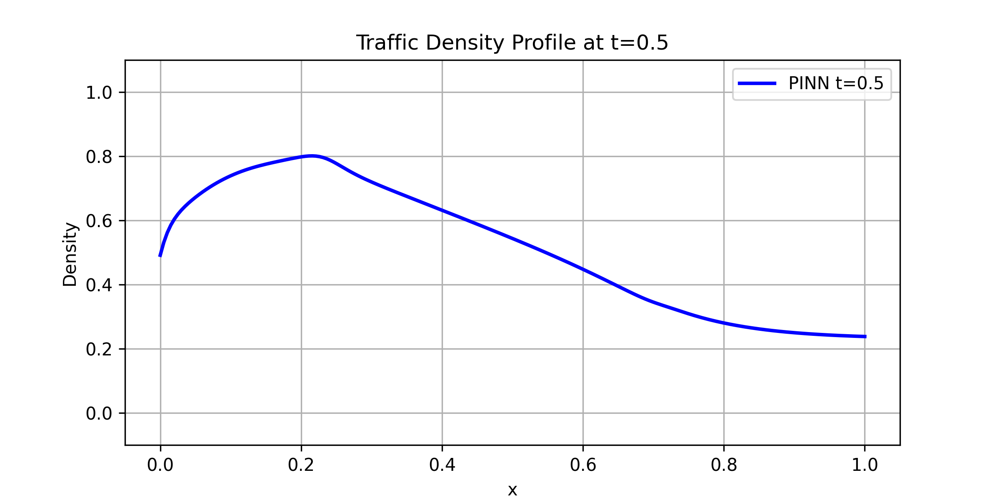
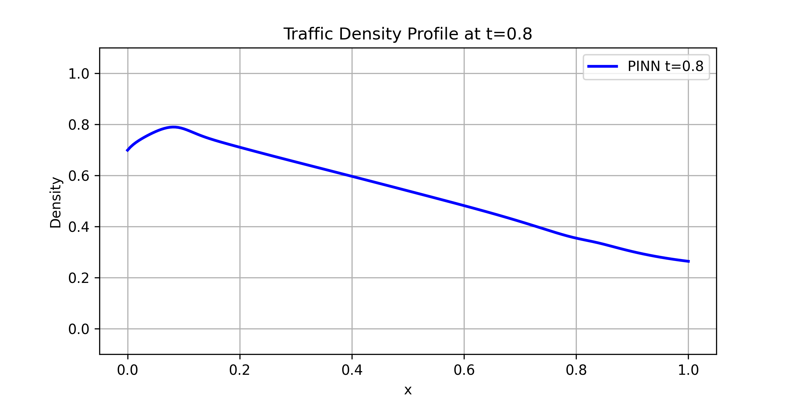
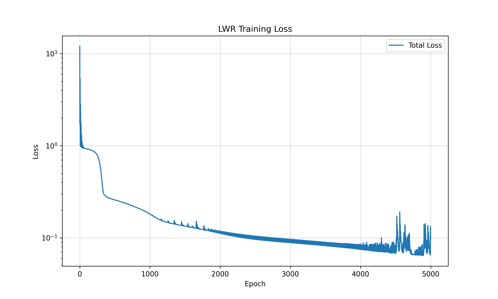

# Traffic Flow Modeling: Lighthill–Whitham–Richards (LWR) Model

[](https://www.python.org/)
[](https://pytorch.org/)
[](https://numpy.org/)
[](https://matplotlib.org/)
[](https://opensource.org/licenses/MIT)

*Numerical simulation, optimization, and wave dynamics analysis of continuum traffic flows (Variant 2).*

---

## Project Overview

This project focuses on the numerical modeling of traffic flow dynamics based on a non-linear hyperbolic conservation law: the **Lighthill–Whitham–Richards (LWR)** macroscopic model, implemented as part of Modular Control Work 2 (MCW-2).

The LWR model describes the spatiotemporal evolution of traffic density $\rho(x, t)$ along a 1D spatial corridor via the first-order partial differential equation (PDE):

$$
\frac{\partial \rho}{\partial t} + \frac{\partial q(\rho)}{\partial x} = 0
$$

where:
* $\rho(x, t)$ is the vehicle density across position $x$ and time $t$,
* $q(\rho) = \rho \cdot v(\rho)$ denotes the traffic flow flux,
* $v(\rho)$ represents the velocity-density relation (e.g., Greenshields model: $v(\rho) = v_{\max} \left(1 - \frac{\rho}{\rho_{\max}}\right)$).

The project solves the boundary value problem, monitors convergence via loss trajectory logging, and reconstructs characteristic shock and rarefaction wave patterns.

---

## Repository Structure

```text
.
├── results_LWR/              # Generated simulation plots & figures
│   ├── loss_history.png      # Optimization loss convergence curve
│   ├── lwr_heatmap.png       # Spatiotemporal density heatmap (x vs. t)
│   ├── profile_t_0.0.png     # Initial condition spatial profile (t = 0.0)
│   ├── profile_t_0.2.png     # Density profile snapshot at t = 0.2
│   ├── profile_t_0.5.png     # Density profile snapshot at t = 0.5
│   └── profile_t_0.8.png     # Density profile snapshot at t = 0.8
├── Second_variant.py         # Main computation & visualization script (Variant 2)
└── README.md                 # Project documentation
```

---

## Simulation Results

### 1. Spatiotemporal Density Heatmap $\rho(x, t)$
Visualizes traffic wave propagation, capturing backward-moving shock waves and forward-propagating rarefaction fans over time:



### 2. Spatial Density Profiles at Discrete Timesteps

| $t = 0.0$ (Initial State) | $t = 0.2$ |
| :---: | :---: |
|  |  |

| $t = 0.5$ | $t = 0.8$ |
| :---: | :---: |
|  |  |

### 3. Convergence & Loss Trajectory
Tracks loss function decay and numerical solver convergence during model execution:



---

## Getting Started

### 1. Clone the Repository
```bash
git clone https://github.com/your-username/MCW-2_Shestopal_M_O.git
cd MCW-2_Shestopal_M_O
```

### 2. Set Up a Virtual Environment
```bash
python -m venv .venv

# Linux / macOS:
source .venv/bin/activate

# Windows (Command Prompt / PowerShell):
.venv\Scripts\activate
```

### 3. Install Dependencies
```bash
pip install numpy matplotlib torch scipy
```

### 4. Run the Simulation
```bash
python Second_variant.py
```
Output plots will be generated and saved automatically to the `results_LWR/` directory.
